<div align="center">

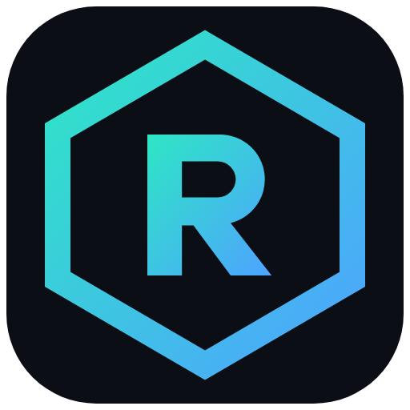

# ratioAI

**A psychedelic, ad-free League of Legends companion app – tier lists, builds, runes, auto-import, ARAM & ARAM: Mayhem augments and live-game scouting, powered by your own Riot API crawler.**

[](https://github.com/ratioAI/ratiLoLAI/actions/workflows/ci.yml)


[**Live web demo**](https://ratioai.github.io/ratiLoLAI/) · [Download](https://github.com/ratioAI/ratiLoLAI/releases) · [Architecture](#architecture)

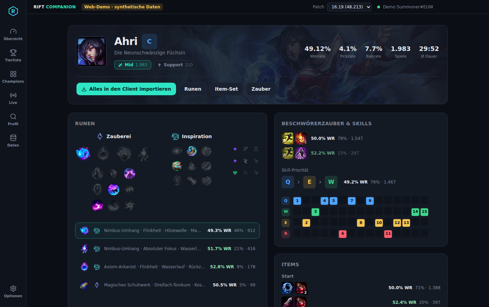

</div>

---

## Why?

Tools like Blitz, Porofessor or op.gg are great – but they are full of ads. ratioAI does the same job as a small, open-source desktop app **without any ads, tracking or third-party backend**. Instead of scraping someone else's statistics it ships its own **match crawler** that talks to the official Riot API and computes every number locally on your machine.

## Features

| | |
|---|---|
| 🏆 **Tier list** | S+ → D tiers per role, computed from win rate (Bayesian-smoothed), pick rate and ban rate. Sortable, filterable, searchable. |
| 📖 **Champion builds** | Most popular & best rune pages, summoner spells, starting items, core build *in purchase order*, boots, situational 4th–6th items, skill order + full 15-level skill path. |
| ⚔️ **Matchups** | Hardest and easiest lane opponents per champion and role. |
| ⚡ **Auto-import** | Detects champion select via the League Client API (LCU) and imports runes, an item set and (optionally) summoner spells the moment you lock in. Flash on D or F – your choice. |
| ✅ **Auto-accept** | Optionally accepts the ready check for you – after a random 2–6 s (or 4–8 s) delay like a person would, not the instant it pops. Accepting or declining yourself cancels it. |
| 🔴 **Live game** | Champion-select overview (allies, enemies, bans), in-game scoreboard via the Live Client Data API, and loading-screen scouting (ranks of all 10 players). |
| ❄️ **ARAM** | Separate ARAM crawler (queue 450) with its own tier list, builds, runes and auto-import. Champion select on the Howling Abyss is detected automatically; since there is no lock-in, the build is imported once your champion has stayed the same for 1.5 s (bench swaps included). |
| 🖼️ **In-game overlay** | When the augment choice appears in ARAM: Mayhem, ratioAI **recognises the three offered cards on screen** (frame detection + OCR of the card titles with a bundled Tesseract model – no memory reading, no injection) and draws a **psychedelic, wobbling tier frame** around each card (a small WebGL shader: full colour flow for S+, purple/pink for S, blue for A … dull bronze for D) with a crest, a *Best pick* marker and a one-line note. Built to stay out of the game's way: screenshots only while an augment is pending **and** the choice can open (dead, game start, after respawn/shopping), a single low-fps screen stream instead of repeated full-screen grabs, three small overlay windows instead of one full-screen surface, the animation capped at 30 fps (15 fps or static selectable), the OCR engine loaded during champion select, and the overlay excluded from screen capture. The augment you click is remembered, so later choices are rated **with the augments you already own**: a card that completes a proven combo is lifted (and labelled *Completes combo*), one that gets you closer is lifted one tier, a known trap sinks to D. Rerolls are picked up within half a second and the frames vanish as soon as the selection is closed. <kbd>Alt</kbd>+<kbd>Shift</kbd>+<kbd>A</kbd> makes it look for the cards right away; Works on any resolution and aspect ratio (16:9, 16:10, 21:9, 4:3) and with any Windows scaling, also on mixed-DPI multi-monitor setups; League must run in **borderless** mode, and the app tells you when it doesn't. |
| ⏱️ **Minimap timers** | Health relic respawns (the game only counts down the first spawn – ratioAI notices when a relic's green cross disappears from the minimap and counts down the 92.5 s) and inhibitor respawns, right on the minimap and on the Live page. |
| 📊 **Game summaries** | After every game: victory/defeat, a win/loss curve (your team's gold lead over time with every kill), highlights (thrown leads, comebacks, most damage/deaths), an impact score per player, MVP – and who of you and your premades was most to blame for a loss. All ten players with items and their augments in tier frames. From the client's match history; saved under *Games*. |
| 🗄️ **Game history** | Every finished game is kept in a local SQLite database (`games.db` in the app's data folder) – no limit, filter by wins and losses, open any old game again. Histories from older versions are imported on first start. |
| 🏆 **Leaderboard** | *Games → Leaderboard*: two podiums showing who of you and your premades was MVP most often and who was the troll most often, plus a sortable table with games, win rate, MVP and troll rates and average impact. |
| 🌌 **Universe & star map** | ratioAI ships with a fixed map of 640 galaxies in 3D – spirals, barred spirals, ellipticals, lenticulars, irregulars, dwarfs, ring galaxies and colliding pairs, each with its own night sky. Every accepted match plays a short film flying you from the planet of your last game to a new one: either through a wormhole (with the target galaxy already visible inside its sphere) or in a swing-by past a ray-traced black hole and its accretion disk, then down into the target galaxy and onto the planet. Click to skip. *Games → Star map* shows the same universe, animated, to turn and zoom, with the galaxies you played in, your route between them and the games played in each. |
| 🌀 **Loading screen** | A panel over the loading screen with every player's recent win rate in ARAM: Mayhem / ARAM (from the client's match history); <kbd>Space</kbd> shows / hides it, it disappears when the game starts. |
| 💀 **Nemesis & old friends** | On the loading screen every stranger you met before gets a small badge and a one-liner from your saved games: *Nemesis* (beat you in most of 3+ games), *Victim*, *Lucky charm* (you win with them), *Jinx*, *Rival* or just *Last time: 2/14/3 Yasuo, 12 days ago* – plus a note when they changed their Riot ID. Your premades never get one. The profile page shows your history with a player and links to your shared games. |
| ✨ **Achievements as constellations** | 28 achievements – pentakills, untouchable wins, *Ratio Approved* augments, MVP streaks, game milestones, galaxies visited and a handful of secret ones. Each one is a constellation in the sky of the star map: locked ones are faint stars, unlocked ones light up in bronze, silver, gold or a cosmic gradient. *Games → Achievements* shows all of them with progress; a new one draws itself star by star after the game. |
| 💬 **Discord webhook** | After every game a summary lands in your friends' Discord channel: result, both teams with K/D/A and quips, MVP and troll, the best highlights and new achievements. Your own webhook (stored encrypted), per mode, optionally only with premades, strangers anonymized by default. Or post any saved game by hand. |
| 🎬 **Clips** | A free replacement for Medal, built in: your games are recorded in full quality – **no paywall, no watermark, no outro, no upload limit** but Discord's own – through Windows' own capture interfaces (nothing is injected into the game). *Instant replay* keeps the last 30 seconds and a hotkey saves them; pentakills, quadras, triples, aces and first bloods are saved on their own; a bookmark hotkey marks a moment for after the game; or keep the whole game. Clips are cut without re-encoding, so saving one costs nothing in the game. Only the League window is captured, never the desktop – and the clip has the whole sound of the moment: the game, your friends on Discord and your music (or only the game, if you prefer); just ratioAI's own sounds are left out. The *Clips* tab is a library with hover previews, filters and search, linked to your games (champion, K/D/A, result). An editor turns clips into montages, slow motion, 9:16 shorts, GIFs and memes – meme text, your quip from the summary, stickers, a stats overlay, music with ducking – and exports them for Discord (fits under 20 MB on its own), as high-quality MP4, short, GIF or WebM. Share through your Discord webhook or save locally: no cloud, no servers, everything stays on your PC. Off by default. |
| ✨ **ARAM: Mayhem** | Augment tips per champion (top combos, strong picks, *traps*), proven multi-augment combinations and the most picked augments per rarity – shown in champion select, **in game** next to the scoreboard and on a dedicated page. Items & runes come from ARAM data, and your **own** Mayhem history (augments you picked, win rate) is read from the League client. |
| 👤 **Profiles** | op.gg-style player lookup: ranks, mastery, last 15 games with KDA, CS/min, items, runes and champion stats. |
| 🕷️ **Own data pipeline** | Crawls Challenger/GM/Master Solo-Queue games of one or more regions, respects Riot rate limits, resumes where it stopped, keeps separate data per patch. |
| 🔐 **Private by design** | Your API key is encrypted with the OS keychain (DPAPI/Keychain) and never leaves the main process. No telemetry. |

<p align="center">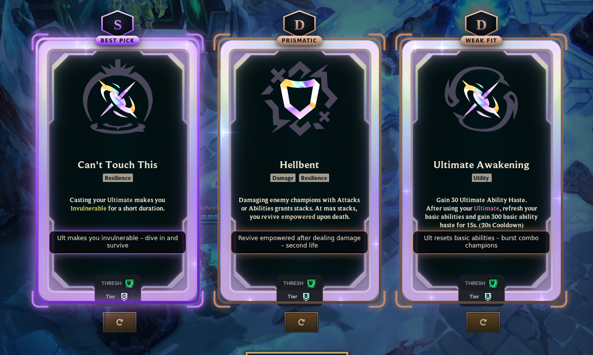<br/><sub>In-game overlay on a real ARAM: Mayhem augment choice</sub></p>

<table>
  <tr>
    <td>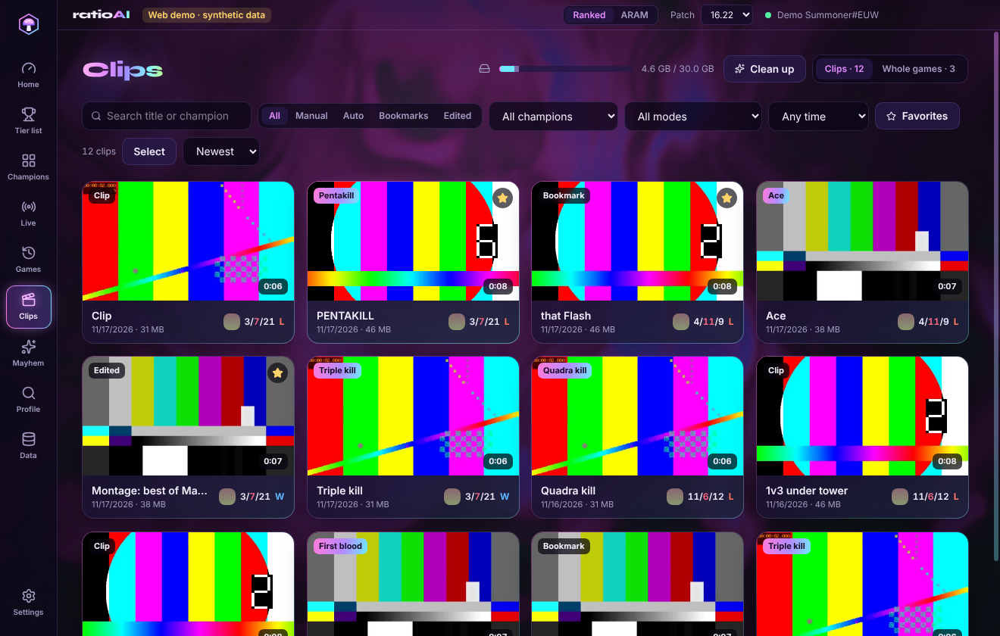</td>
    <td>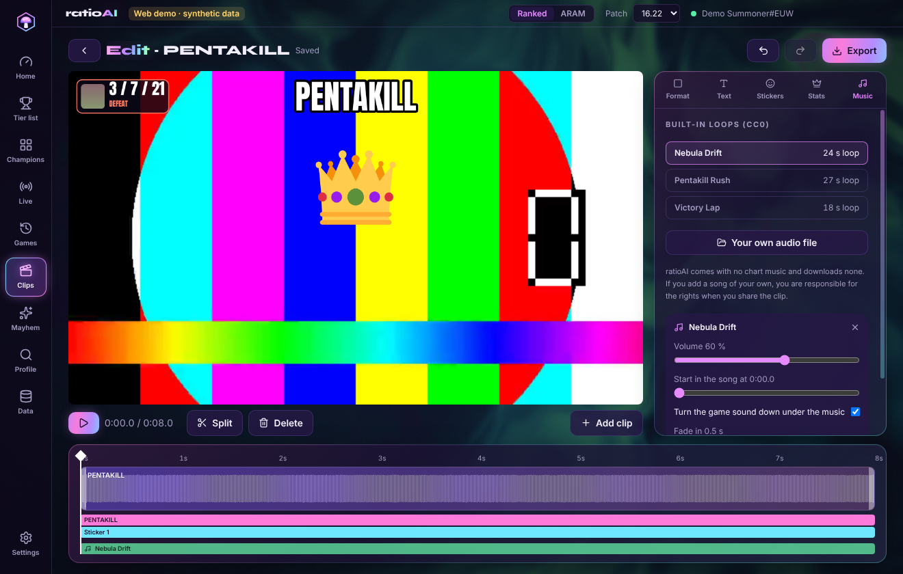</td>
  </tr>
  <tr>
    <td colspan="2" align="center">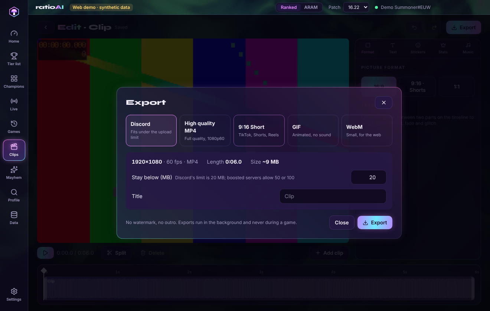<br/><sub>Clips: library, editor and export (web demo – the clips are FFmpeg test pictures)</sub></td>
  </tr>
</table>

<table>
  <tr>
    <td>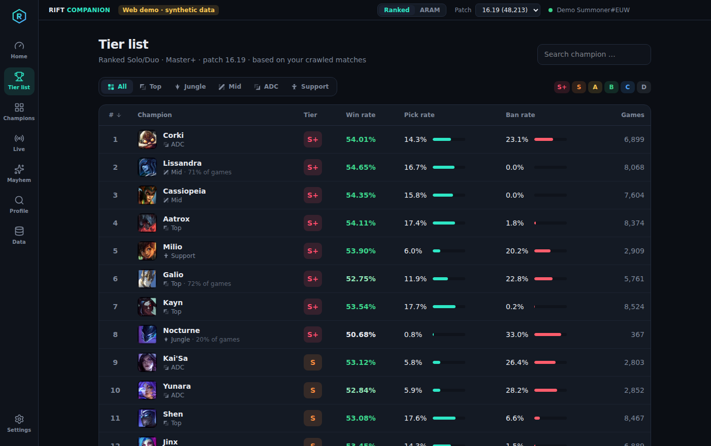</td>
    <td>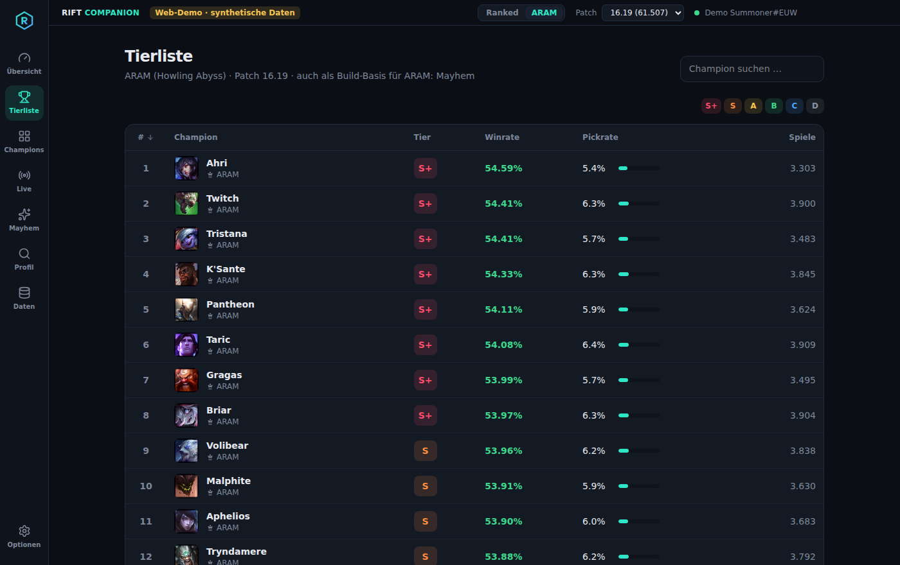</td>
  </tr>
  <tr>
    <td>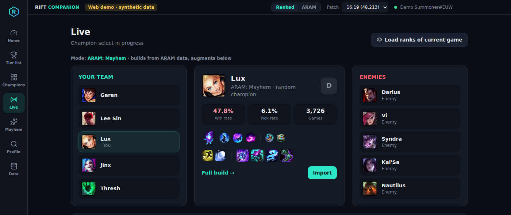</td>
    <td>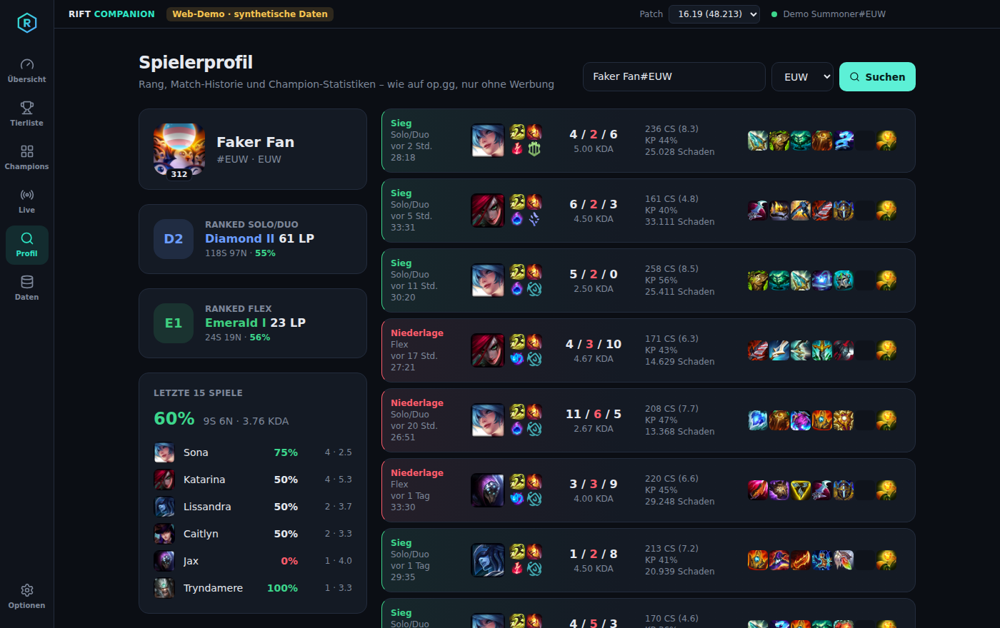</td>
  </tr>
</table>

<p align="center">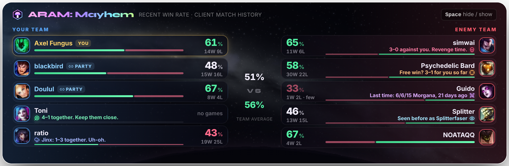<br/><sub>Loading screen: Nemesis, Victim, Lucky charm, Jinx, Rival and familiar faces from your own games</sub></p>

<table>
  <tr>
    <td>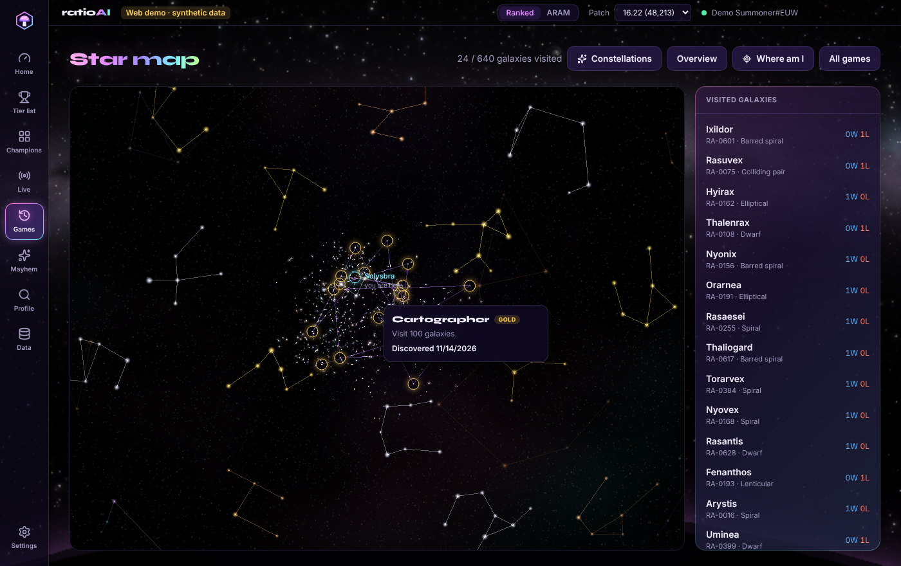</td>
    <td>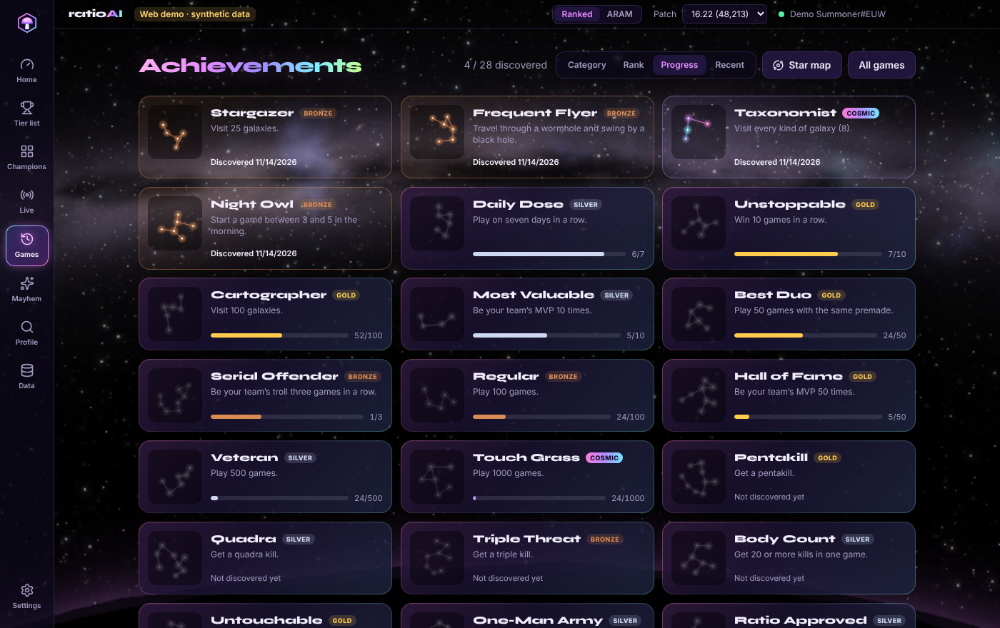</td>
  </tr>
</table>

> Screenshots are taken from the web demo, which runs on **synthetic** statistics. The desktop app only shows data it crawled itself.

### A note on ARAM: Mayhem

Riot deliberately **blocks Mayhem matches in the public API** (they return `403`) and asks developers **not to publish augment win rates**, so that the mode isn't "solved" by stat sites ([developer-relations #1109](https://github.com/RiotGames/developer-relations/issues/1109)). ratioAI respects that:

- Augment names, rarities and icons come from the game client data on [CommunityDragon](https://www.communitydragon.org/).
- Pick rates and curated combos come from the open dataset of [arammayhem.com](https://arammayhem.com/data/) (CC BY 4.0, China servers) – *Data: arammayhem.com*.
- Items, runes and skill order for Mayhem come from your own crawled **ARAM** games.
- Your personal Mayhem statistics are computed locally from your own match history in the League client and never leave your PC.
- **Augment tiers** per champion combine curated combos (top combo → S+, trap → D), the augment's pick rate within its rarity and whether it fits the champion's archetype (AP, AD, crit, on-hit, tank, enchanter). The one-line notes are hand-written.

## Getting started

### 1. Install

Download the latest `ratioAI-Setup-x.y.z.exe` from [Releases](https://github.com/ratioAI/ratiLoLAI/releases) – or build it yourself:

```bash
git clone https://github.com/ratioAI/ratiLoLAI.git
cd ratiLoLAI
npm install
npm run dev        # start in development mode
npm run dist:win   # build the Windows installer into ./release
```

Requires Node.js 20+.

### 2. Get a Riot API key

1. Sign in at [developer.riotgames.com](https://developer.riotgames.com/).
2. Copy the **Development API Key** (valid for 24 h) – or register a *Personal API Key* for long-term use.
3. Paste it in **Optionen → Riot API** inside the app and pick your region.

### 3. Crawl some games

Open **Data**, pick *Ranked Solo/Duo* or *ARAM* and hit **Start crawler**. The crawler fetches the apex leagues of your region(s), downloads recent ranked games including their timelines and aggregates them. With a development/personal key (100 requests / 2 min) you get roughly **20–25 matches per minute**; a few thousand matches already give a very usable tier list. Progress is stored continuously – just let it run in the background.

### Updates

Installed builds update themselves: on start (and every 4 h) the app checks GitHub Releases, downloads a new version in the background and installs it when you close the app – no manual reinstalling. For development use `npm run dev` (hot reload, nothing to install).

### 4. Play

Start the League client. ratioAI connects automatically; when you lock in a champion your runes and item set are imported.

## Architecture

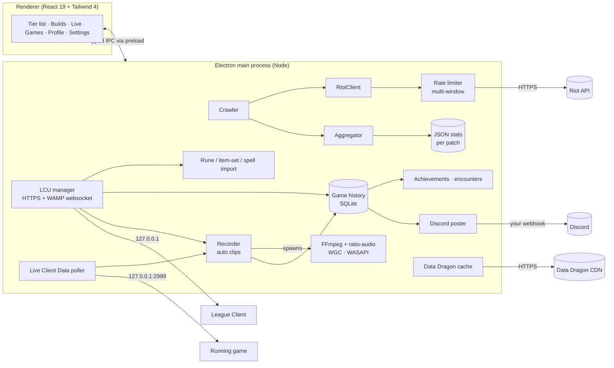

```
src/
├─ main/              Electron main process
│  ├─ riot/           Riot API client + sliding-window rate limiter
│  ├─ crawler/        crawler, match/timeline aggregator, persistent stats store
│  ├─ lcu/            League client discovery, websocket events, champ select, import payloads
│  ├─ live/           Live Client Data API (in-game)
│  ├─ ddragon.ts      static data download + cache
│  ├─ games.ts        game history database (SQLite, versioned migrations) + leaderboard + encounters
│  ├─ achievements.ts achievements: full evaluation at start, then per game; flights
│  ├─ discord.ts      Discord webhook poster (dedupe, rate limits)
│  ├─ recorder/       Clips: FFmpeg download + encoder test, recorder service (segments, ring,
│  │                  hotkeys, automatic clips), clip store, rcclip:// protocol, exporter, sharing
│  └─ profile.ts      summoner profiles & live-game scouting
├─ preload/           contextBridge – exposes a typed `window.rc` API
├─ renderer/          React UI (also builds as a standalone web demo)
└─ shared/            types, tier/build analysis, static-data parsing, the universe catalogue
                      and flight path (pure & tested)
native/audio/         ratio-audio.exe (Rust): the PC's sound (all but ratioAI, or the game only) through WASAPI process loopback
test/                 Vitest unit + integration tests (crawler against a fake Riot API)
```

### How Clips record

```
League window ──Windows Graphics Capture──▶ FFmpeg (gfxcapture, D3D11 frames stay on the GPU)
                                              │  NVENC / AMF / Quick Sync, constant quality,
PC sound but ratioAI ─WASAPI process loopback─▶ ratio-audio.exe ─named pipe (PCM)─▶ │  keyframe every second
                                              ▼
                              2-second fMP4 segments + segments.csv   (ring of the last 30 s, or the whole game)
                                              ▼
              hotkey · automatic clip · bookmark  ──▶  concat + stream copy  ──▶  clip.mp4 + thumbnail
```

- **FFmpeg is its own program**, not linked into the app and not part of the installer: an LGPL build (no x264/x265) is downloaded once from this repository's release assets, checked against a SHA-256 written into the code and unpacked into the app's data folder (`shared/ffmpegBuild.ts`).
- **Hardware encoders only** (tested once, best first: AV1 → HEVC → H.264 on NVIDIA, AMD or Intel). Without one the recorder stays off – there is no x264 fallback, because software encoding next to a game costs frames.
- **Nothing blocks the game.** FFmpeg and the sound helper run at below-normal priority; the capture hands out frames from a pool of two, so when the encoder cannot keep up frames are dropped in the recording, never in the game. Clips are stream copies of finished segments. The recorder has no timer of its own: automatic clips, the ring and the status hang on the live poll that already runs every two seconds.
- **Automatic clips** come from the Live Client Data event feed (`Multikill`, `FirstBlood`, `Ace`, `ChampionKill`, `GameEnd`): each kind has a lead-in and lead-out, overlapping moments become one clip, and when the app starts in the middle of a game nothing is made up for the past.
- **Storage** has a limit (30 GB by default). The cleanup deletes leftovers of replay recordings first, then whole-game recordings older than a week that were not marked *keep* – never clips or favorites – and shows what it would delete before it does.

#### Frame rate cost and file sizes

The goal is **less than 3 % fewer frames** while recording. How to measure it on your PC: play a practice-tool game (or a replay) with the frame-rate display on (<kbd>Ctrl</kbd>+<kbd>F</kbd>), frame cap off, standing in the same spot; note the average for a minute with *Record my games* off and for a minute with it on. The Admin tab's *Record without a game* shows the megabytes per minute your encoder really produces.

| | Without recording | Compact | High | Original |
|---|---|---|---|---|
| Average FPS | *not measured yet* | *not measured yet* | *not measured yet* | *not measured yet* |

> The table is empty on purpose: this version was built without access to a Windows PC with League, so no number here would be a measurement. Fill it in with the method above (GPU, driver, resolution).

File sizes are estimated from typical League bitrates (the settings page shows the estimate for your encoder; real numbers depend on how much moves on screen):

| Profile | Picture | AV1 | HEVC | H.264 |
|---|---|---|---|---|
| Compact | up to 1080p60 | ~46 MB/min | ~57 MB/min | ~84 MB/min |
| High | up to 1440p60 | ~94 MB/min | ~117 MB/min | ~174 MB/min |
| Original | native | ~91 MB/min at 1080p | ~114 MB/min at 1080p | ~166 MB/min at 1080p |

### How the numbers are computed

- **Only ranked Solo/Duo, current patch, Master+.** Remakes and games with missing positions are discarded.
- **Win rate** used for ranking is Bayesian-smoothed with 30 virtual 50 % games, so a champion with 6/6 wins doesn't end up S+.
- **Strength score** = `(smoothedWR − 50) · 100 + 0.8 · ln(1 + pickRate%) + 0.05 · banRate%`, ranked **within each role**. Tiers are percentiles: S+ top 5 %, S 15 %, A 35 %, B 60 %, C 85 %, D rest.
- **Item builds** are reconstructed from the match *timeline* (`ITEM_PURCHASED` / `ITEM_UNDO`), so the core build shows the real purchase order and undone purchases don't count.
- **Skill order** comes from `SKILL_LEVEL_UP` events; the max order is the order in which Q/W/E reach rank 5.

## Development

```bash
npm run dev         # Electron + Vite with hot reload
npm test            # Vitest (341 tests)
npm run typecheck   # strict TypeScript for main + renderer
npm run build:web   # standalone web demo in ./dist-web (synthetic data)
npm run screenshots # README screenshots of the 1.2 and 1.3 features from the built web demo (needs internet)
npm run build:audio # Clips: builds native/audio (Rust) into resources/bin/ratio-audio.exe – Windows only
```

**Clips in development.** The recorder needs two programs that are not in the repository: the sound helper (`npm run build:audio` with [Rust](https://rustup.rs), or the `ratio-audio` artifact of a CI run, saved as `resources/bin/ratio-audio.exe`) and FFmpeg 8.1 or newer. For FFmpeg either publish the build as described in `src/shared/ffmpegBuild.ts`, or point the development app at a local one: `set RATIO_FFMPEG=C:\path\to\ffmpeg.exe` before `npm run dev` (ignored by the installed app). Without the helper clips have no sound; without a hardware encoder nothing is recorded.

`npm run dev` also adds an **Admin** tab with developer tools: flights to any galaxy type (wormhole or black hole), the in-game overlays without a game (including loading-screen lobbies with every kind of encounter, or built from your own history), a simulated League client and ARAM game (inhibitor and relic events, fights with multikills and aces for the automatic clips), test games for the post-game summary, achievements (unlock, reset, play the animation), the Discord message of your newest game, the live overlay log and a relic pad calibration for maps the timers don't know yet. For Clips it has an encoder test, *Reload FFmpeg*, *Record without a game* (20 s of a test picture or of the main screen through the real pipeline), a test recording the simulated game can cut automatic clips from, the ring buffer and *Clip now*. Builds leave all of it out (`import.meta.env.DEV`), so it is never part of the installer.

CI runs type checks, tests and both builds on every push. Tagging `v*` builds the Windows installer and attaches it to a GitHub release; `main` is deployed as the web demo to GitHub Pages.

## Is this allowed?

ratioAI only uses **official, documented interfaces**: the public Riot API, the League Client API (LCU – the same interface Blitz, Porofessor, Mobalytics etc. use for rune import) and the in-game Live Client Data API. It does not read game memory or inject anything into the game, so it is not affected by Vanguard. For personal use a development or personal API key is sufficient; if you want to distribute the app publicly with a shared key you have to register it as a product with Riot.

The 1.2 features add nothing to that list: encounters and achievements are worked out from your own game database. **Discord posts only go to the webhook URL you enter yourself** (stored encrypted, never shown again), nothing is sent anywhere else, and players who aren't you or your premades appear only as their champion unless you switch that off.

**Clips (1.3) record only through operating system interfaces.** The picture comes from Windows Graphics Capture (or Desktop Duplication/DXGI as a fallback), the sound from WASAPI process loopback. There is **no hook and no injection into the game process** (so nothing like OBS's "Game Capture"), no memory is read, and the helper never even opens the game process – it finds the window by its title and gives Windows the process id. Only the League window is captured, never the whole desktop. The sound is by default **everything your PC plays except ratioAI** – the game, Discord voice, music – so a clip sounds like the moment did; in Settings › Clips it can be limited to the game process alone. Your own voice is only in a clip with the microphone switched on (off by default). Keep in mind that a shared clip then carries your friends' voices too. Game events for automatic clips come from the Live Client Data API (127.0.0.1:2999) and the client (LCU), nothing else. Clips never leave your PC unless you share them.

## Third-party licenses

| | License | Where |
|---|---|---|
| [FFmpeg](https://ffmpeg.org) 8.1 (LGPL build, no x264/x265) | LGPL-2.1-or-later | Runs as its own program, downloaded on first use; it is not linked into ratioAI. Build and source: [BtbN/FFmpeg-Builds](https://github.com/BtbN/FFmpeg-Builds), [ffmpeg.org](https://ffmpeg.org/download.html). License text: [LGPL 2.1](https://www.gnu.org/licenses/old-licenses/lgpl-2.1.html). |
| [Anton](https://github.com/googlefonts/AntonFont) (meme text) | SIL Open Font License 1.1 | `resources/fonts/` with the license text, and `@fontsource/anton` |
| [Twemoji](https://github.com/jdecked/twemoji) 15 (24 emoji stickers) | CC-BY 4.0, © Twitter, Inc and other contributors | `src/renderer/src/assets/stickers/` |
| [wasapi-rs](https://github.com/HEnquist/wasapi-rs), serde_json (sound helper) | MIT / MIT or Apache-2.0 | `native/audio/` |
| Built-in music loops | CC0 1.0, synthesized by `scripts/make-music.py` | `src/renderer/public/music/` |

ratioAI ships no chart music, no commercial fonts and no sticker packs; music of your own that you add to a clip is your responsibility when you share it.

## Legal

ratioAI isn't endorsed by Riot Games and doesn't reflect the views or opinions of Riot Games or anyone officially involved in producing or managing Riot Games properties. Riot Games, and all associated properties are trademarks or registered trademarks of Riot Games, Inc.

Code licensed under [MIT](LICENSE).
